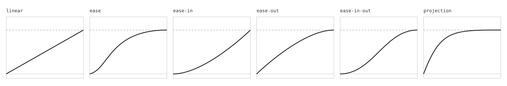

# Curves and `linear()`

`@hannasage/armature/curves` holds timing curves. A curve is a function from progress to a value. Progress runs from 0 at the start of a move to 1 at its end.
It has a cubic-bezier evaluator, named easings, a tween, a tween controller, and a fitting aid.
`@hannasage/armature/linear` writes a spring or a curve as a CSS `linear()` string.
Both entries read no DOM and no environment, so they run on a server, in a build step, or in a test.

```ts
import { bezier, createTween, easing, stepTween } from "@hannasage/armature/curves";
import { toEasing, toLinear } from "@hannasage/armature/linear";

const out = easing("ease-out");
out(0.5); // the eased value at half the time
out.css; // "cubic-bezier(0, 0, 0.58, 1)"

let tween = createTween(0, 100, 0.4, bezier(0.16, 1, 0.3, 1));
tween = stepTween(tween, 1 / 60);

toLinear({ stiffness: 170, damping: 26 }); // "linear(0, 0.0327 2.1505%, ... 1)"
```

A spring is physics: its time comes from its stiffness, damping, and mass. A curve is a fixed time with a shape. Armature is physics first, so use a spring for anything a person can interrupt. If a design asks for a set time, such as a fade, use a curve.

## The bezier

`bezier(x1, y1, x2, y2)` returns an easing. An easing is a curve that also has `css`, its CSS text, and `points`, its four control numbers. It is the curve of CSS `cubic-bezier(x1, y1, x2, y2)`.

The curve starts at (0, 0) and ends at (1, 1). The x axis is progress and the y axis is the eased value:

```
B(t) = 3 (1 - t)^2 t P1 + 3 (1 - t) t^2 P2 + t^3
```

`P1` is `(x1, y1)` and `P2` is `(x2, y2)`. For a progress x, the evaluator solves for the t where the x of the curve is x, and returns the y at that t.

- x1 and x2 must be from 0 to 1, as in CSS. Another value throws a `TypeError`.
- y1 and y2 can be any finite number, so a curve can overshoot.
- A progress below 0 gives 0, and a progress of 1 or more gives 1.

## Named easings

`easings` holds the control points of six curves as data. `easing(name)` builds one. An unknown name throws a `TypeError` that lists the names.



The values below are measured from the evaluator. A quarter and a half are shares of the time of the move.

| Name | Control points | Value at a quarter | Value at a half |
| --- | --- | ---: | ---: |
| `linear` | `0, 0, 1, 1` | 0.2500 | 0.5000 |
| `ease` | `0.25, 0.1, 0.25, 1` | 0.4085 | 0.8024 |
| `ease-in` | `0.42, 0, 1, 1` | 0.0935 | 0.3154 |
| `ease-out` | `0, 0, 0.58, 1` | 0.3781 | 0.6846 |
| `ease-in-out` | `0.42, 0, 0.58, 1` | 0.1292 | 0.5000 |
| `projection` | `0.22, 1, 0.36, 1` | 0.7649 | 0.9614 |

The first five are the CSS keywords. `projection` is the curve that Projection UI uses for its glow reveal: a fast start and a long soft end.

## The tween

A tween moves one number from A to B in a set time along a curve. It has the step interface of the spring: a state goes in with a time slice in seconds, and a new state comes out. Every function is pure.

- `createTween(from, to, duration, curve?)` makes a tween. The duration is in seconds. The curve is a straight line by default.
- `stepTween(state, dt)` moves it on by `dt` seconds. A slice that is 0, below 0, or not finite changes nothing.
- `isTweenDone(state)` says whether the tween is at its end.
- `retargetTween(state, to, duration?, curve?)` starts a new tween from the value on screen.

A tween ends exactly on its target. The last slice writes the target and not the curve, so no rounding error is left.

`createTweenValue(scheduler, kind, initial, options)` runs a tween over any kind on the shared frame scheduler. It is the fixed-time partner of `createValue` in `@hannasage/armature/values`, so a tween can move a color, a path, or a 3D transform. The options are `duration`, `curve`, `onChange`, and `reducedMotion`. When `reducedMotion` returns true, a move jumps to its target. See `docs/kinds.md` for the kinds.

## Fit a bezier

`fitBezier(samples)` fits one cubic-bezier to a sampled curve. It returns the control points, the CSS text, and the error: the largest gap between the fitted curve and any sample. It is a search with no random numbers, so the same samples always give the same answer. There is no visual editor.

A bezier cannot ring. It turns at most twice, so a spring that overshoots and settles does not fit well. If a browser has no `linear()`, `toEasing` uses this fit and reports the error.

- For the spring `{ stiffness: 170, damping: 26 }`, the best bezier is off by 0.0177 at most.
- For the bouncier spring `{ stiffness: 170, damping: 12 }`, it is off by 0.0723.

Both are above the default tolerance, so `toEasing` marks both results `degraded`.

## `linear()`

CSS `linear()` is a timing function made of stops. A browser draws straight lines between them. With enough stops it can follow any curve, a spring too.

`toLinear(source, options?)` writes a spring or a curve as a `linear()` string. A spring is sampled with the solver's own fixed step, so the stops follow what the solver draws. The exporter keeps the fewest stops that stay within the tolerance of the samples.

- `tolerance` is the largest gap allowed, in the units of the value. The default is 0.005. The smallest allowed is 0.0005, because the stops are written with 4 decimals.
- `duration` is in seconds, for a curve only. A spring has its own duration: the time the solver takes to rest.
- A spring that has not rested after 10 seconds throws a `RangeError`, so a spring with no damping cannot give an endless string.

`fitLinear(source, options?)` returns the same string with what it measured: `css`, `duration`, `count` (the number of stops), `error`, and `truncated`.

For the spring `{ stiffness: 170, damping: 26 }`:

- At the default tolerance it needs 15 stops. It rests in 775 ms, and the largest error is 0.0045.
- At a tolerance of 0.001 it needs 34 stops.

## Browser support

`supportsLinear(probe?)` says whether the browser knows `linear()`. It calls `CSS.supports` by default, and a test passes its own probe.

`toEasing(source, options?)` picks for the browser that runs it:

- With `linear()` support, it returns the `linear()` string.
- Without it, it fits one cubic-bezier to the same samples and returns `cubic-bezier(...)`. If the error is above the tolerance, `degraded` is true. `maxError` turns a result with more error into a `RangeError`.
- A source that is already a bezier comes back as its own `cubic-bezier(...)`, because CSS reads that natively.
- A spring that has not rested in time is `truncated: true` here, where `toLinear` throws.

`cssLinear` in `@hannasage/armature/css` is `toLinear` under a name that says it returns CSS. See `docs/css.md`.

## Size

The sizes of `/curves` and `/linear` and their caps are in `docs/baseline.md`, section "G8 build".
