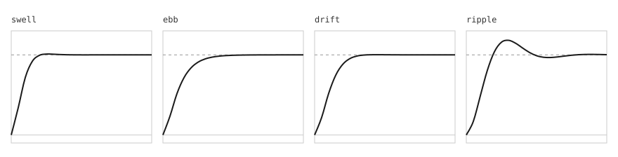

# Write a flavor

A flavor is a named movement language. It holds the names, the numbers, and the spring presets. The engine holds the physics and reads the flavor. `docs/flavors.md` lists every field of the contract. This guide builds one flavor from the start, with the parts that amendment 1 added: a follower, a gesture, a timeline, and a layout.

The flavor is Tide, the motion of a bottom sheet. A sheet rises from the bottom of the screen, and the page behind it dims. Its rows rise one after another. A finger drags the sheet between three heights, and a flick down closes it. Rows that change order glide to their new places, and a row can open into a full card.

The code is in `examples/tide/flavor.ts` and `examples/tide/sheet.ts`. It imports only the public entries, as a flavor in another repository does. `tests/examples/tide.test.ts` runs it through every controller. `tests/docs/guide.test.ts` checks that every code block on this page is in those two files, and that every number on this page is measured.

## Start from the type

Import the type and the parts you need from the public entries. The layout part has its type in `/layout`.

```ts
import { criticalDamping, defineFlavor, type Flavor, type FollowerFlavor, type GestureFlavor, type TimelineFlavor } from "@hannasage/armature";
import type { LayoutFlavor } from "@hannasage/armature/layout";
```

Pick a prefix. Every CSS variable and data attribute of the flavor starts with it. It is lowercase letters, digits, and hyphens, and it starts with a letter. Choose one that no other code on the page uses. Tide uses `tide`, so its dim is `--tide-dim`.

## Choose the springs

A spring is the heart of a flavor. Every spring obeys one equation:

```
m x'' + c x' + k x = 0
```

`x` is the distance from the target, `m` is the mass, `c` is the damping, and `k` is the stiffness. Two numbers describe the feel:

- The natural frequency `ω0 = sqrt(k / m)` is how fast the spring swings.
- The damping ratio `ζ = c / (2 sqrt(k m))` is how much it rings. Below 1 a spring is underdamped and overshoots. At 1 it is critical and returns fastest with no overshoot. Above 1 it is overdamped and creeps.

`criticalDamping(k, m)` returns `2 sqrt(k m)`, the damping of a critical spring.

```ts
/** The sheet coming to rest on a height. A little overshoot, so the sheet lands with weight. */
const swell = Object.freeze({ stiffness: 380, damping: 30, mass: 1 });
/** The dim and every exit. Critically damped, so nothing bounces on the way out. */
const ebb = Object.freeze({ stiffness: 260, damping: criticalDamping(260, 1), mass: 1 });
/** A row that moves to a new place. Close to critical, so a list that changes order does not wobble. */
const drift = Object.freeze({ stiffness: 220, damping: 26, mass: 1 });
/** A row that rises into place. Loose, so the list ripples as it arrives. */
const ripple = Object.freeze({ stiffness: 140, damping: 12, mass: 1 });
```



### What the solver measures

The solver steps the equation in fixed slices with semi-implicit Euler. That adds a little damping, so a spring overshoots less than the closed-form answer says. Choose a spring from the measured numbers, not from the formula. The settle time is the time after which the value stays inside 2 percent of the target.

#### swell

- Constants: stiffness 380, damping 30, mass 1.
- Natural frequency: 19.5 radians per second.
- Damping ratio 0.769. It is underdamped.
- Measured overshoot: 1.0 percent.
- Measured settle time: 185 ms.
- Closed-form overshoot: 2.3 percent.
- Closed-form settle time: 281 ms.

#### ebb

- Constants: stiffness 260, damping 2 sqrt(260), mass 1. The damping is 32.2.
- Natural frequency: 16.1 radians per second.
- Damping ratio 1.000. It is critically damped.
- Measured overshoot: 0.0 percent.
- Measured settle time: 380 ms.
- Closed-form overshoot: 0.0 percent.
- Closed-form settle time: 362 ms.

#### drift

- Constants: stiffness 220, damping 26, mass 1.
- Natural frequency: 14.8 radians per second.
- Damping ratio 0.876. It is underdamped.
- Measured overshoot: 0.0 percent.
- Measured settle time: 315 ms.
- Closed-form overshoot: 0.3 percent.
- Closed-form settle time: 300 ms.

#### ripple

- Constants: stiffness 140, damping 12, mass 1.
- Natural frequency: 11.8 radians per second.
- Damping ratio 0.507. It is underdamped.
- Measured overshoot: 14.8 percent.
- Measured settle time: 637 ms.
- Closed-form overshoot: 15.7 percent.
- Closed-form settle time: 676 ms.

`drift` is underdamped by the formula, and the solver measures no overshoot for it. The extra damping of the solver is enough to stop it. This is why the measured numbers decide.

## Add a follower

A follower springs one number and writes it as a CSS variable. The stylesheet decides what the number means. Tide has one: the dim of the page behind the sheet.

```ts
/** `dim`: how dark the page behind the sheet is, from 0 to 1. */
const followers: FollowerFlavor = {
  dim: { var: "dim", springKey: "ebb", rest: { restDelta: 0.001, restSpeed: 0.01 } },
};
```

- `var` is the suffix of the variable. It is unique across every part of the flavor.
- `springKey` names a spring in `springs`.
- `rest` holds the limits at which the follower stops. A fraction from 0 to 1 needs to look still, not to be exact.

## Add a gesture

The gesture part holds the numbers of a drag: the decay, the rubber band, the swipe, the snap spring, and the rest limits. It names no variable, because a drag writes `translate`. See `docs/gesture.md`.

```ts
/** The sheet under a finger. A flick of 900 px per second over 48 px is a swipe. */
const gesture: GestureFlavor = {
  friction: 6,
  rubberBand: { stiffness: 420, reach: 72 },
  swipe: { velocity: 900, distance: 48 },
  springKeys: { snap: "swell" },
  rest: { restDelta: 0.5, restSpeed: 6 },
};
```

- `friction` is c in the decay `v' = -c v`, per second. A larger number stops a flick sooner.
- `rubberBand.reach` is the most a pointer can pull the sheet past a bound, in pixels. `rubberBand.stiffness` is how hard the band pulls back.
- If a release reaches both `swipe.velocity` and `swipe.distance`, it is a swipe. The sheet closes on a swipe down, so these two keep a slow drag from closing it.
- `springKeys.snap` is the spring a release takes to the nearest height.

## Add a timeline

The timeline part holds named curves and named sequences of keys. A track names a sequence in place of its own keys, so the timing lives in the flavor and the code only says what moves.

```ts
const timeline: TimelineFlavor = {
  curves: { "tide-out": [0.16, 1, 0.3, 1], "tide-in": [0.7, 0, 0.84, 0] },
  defaultCurve: "tide-out",
  sequences: {
    rise: { keys: [[0, 0], [220, 1]] },
    "settle-in": { keys: [[0, 24], [480, 0, "ripple"]] },
    "fade-out": { keys: [[0, 1], [160, 0, "tide-in"]] },
  },
};
```

- A key is `[time in ms, value, step?]`. A step names a curve of this part or a spring of `springs`.
- A key with no step takes `defaultCurve`. So `rise` fades in on `tide-out`.
- `settle-in` springs on `ripple`. The spring starts at the time of the key before it, and the timeline lasts until the spring rests.
- A curve name must not be the name of a spring, because a step names one or the other.

## Add a layout

The layout part holds the springs of layout changes, shared elements, and exits, and one rest limit in pixels.

```ts
/** Rows move on `drift`, and the sheet leaves on `ebb`. A move rests within a quarter of a pixel. */
const layout: LayoutFlavor = {
  springKeys: { move: "drift", exit: "ebb" },
  rest: { restDelta: 0.25, restSpeed: 4 },
};
```

## Put it together

`defineFlavor` checks the flavor, freezes it at every level, and returns it. A flavor must not change after it is made.

```ts
export const tide = defineFlavor<Flavor & { followers: FollowerFlavor; gesture: GestureFlavor; timeline: TimelineFlavor; layout: LayoutFlavor }>({
  name: "tide",
  prefix: "tide",
  logLabel: "tide-motion",
  springs: { swell, ebb, drift, ripple },
  followers,
  gesture,
  timeline,
  layout,
});
```

Tide has no `surface`, `lens`, or `reveal` part. A sheet has no press glint, no travelling indicator, and no scroll reveal. A flavor carries only the parts it uses.

What is checked, and when:

- `defineFlavor` and `validateFlavor` check the top level, the springs, the followers, and the gesture part.
- `createTimeline` and `requireTimeline` check the timeline part. `createLayout`, `createPresence`, `createShared`, and `requireLayout` check the layout part. `validateFlavor` does not check these two parts, because the spring-only entry has no room for the code. A bad timeline or layout part fails at the start of its controller.

## Use it

Each controller takes the flavor. The sheet in `examples/tide/sheet.ts` makes one of each.

```ts
  const dim = createFollower(backdrop, { flavor: tide, name: "dim", env: envs.page });
  const drag = createDrag(sheet, { flavor: tide, axis: "y", bounds: [0, height], snap: [0, height / 2, height], env: envs.pointer });
  const presence = createPresence(page, { flavor: tide, env: envs.layout });
  const shared = createShared({ flavor: tide, env: envs.layout });
  const layouts = rows.map((row) => createLayout(row, { flavor: tide, env: envs.layout }));
```

The rows rise on two tracks each, one for the opacity and one for the offset. Each track names a sequence of the flavor, and each row starts a little after the one before it.

```ts
  const enter = createTimeline(envs.timeline ?? createBrowserTimelineEnvironment(), {
    flavor: tide,
    tracks: rows.flatMap((row, i) => [
      { target: row, value: "opacity", sequence: "rise", offset: i * ROW_STAGGER },
      { target: row, value: "translate", sequence: "settle-in", offset: i * ROW_STAGGER, format: (y: number) => `0px ${y}px` },
    ]),
  });
```

A flick down closes the sheet. The dim springs back to 0, the drag stops, and presence slides the sheet out from where the finger left it. At rest, the sheet is removed from the page.

```ts
  function close() {
    if (closed) return;
    closed = true;
    stopSwipe();
    dim.setTarget(0);
    const { y } = drag.getState();
    drag.destroy();
    presence.exit(sheet, { from: [0, y], to: { y: height - y, scale: 1 } });
  }
```

A change of order is a layout change. Measure every row, change the page, and play.

```ts
    reorder(change) {
      for (const layout of layouts) layout.snapshot();
      change();
      for (const layout of layouts) layout.play();
    },
```

The CSS output writes the flavor as a stylesheet, so the dim has a start value before any script runs. `cssFlavor(tide)` gives this text. See `docs/css.md`.

```css
@property --tide-dim { syntax: "<number>"; inherits: true; initial-value: 0; }
```

## Test it

Every environment is optional, and a test passes fakes. `tests/examples/tide.test.ts` does this. It checks these things:

- The flavor holds together, and has each of the four parts.
- It is not a copy of glass or Projection. Its name, prefix, label, and springs differ, and it carries none of their parts.
- Opening the sheet dims the page to 1 and plays the rows in order.
- A slow release rests on the nearest height.
- A flick down closes the sheet. At rest, the sheet is removed.
- A change of order glides each row to its new place, and a row opens into a card as one element.
- Under reduced motion the dim and the rows land with no frame.
- `destroy` stops every controller.

## Stable and experimental parts

A part of the contract is marked stable only after two real flavors use it. `docs/contract-review.md`, section "Review after the third flavor", has the status of each part and the reason.
